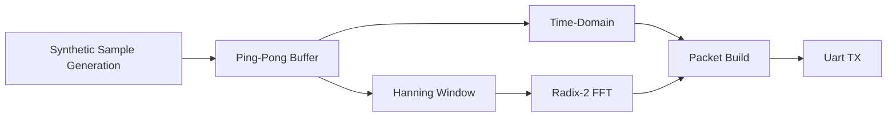

<p align="center">
    
</p>

<p align="center">
    <stron>Emulated DSP Pipeline Verification Loop</strong>
    <br/>
    This recording captures the bare-metal DSP pipeline (metadata, time-domain, and FFT magnitudes) executing in real time inside the Renode simulation framework.
</p>

## Synthetic Wave Generation, Windowing, and FFT

A high-performance digital signal processing (DSP) pipeline optimized for resource-constrained microcontrollers. This repository implements real-time synthetic signal generation, Hanning window application, and a Radix-2 Decimation-In-Time (DIT) Fast Fourier Transform (FFT) calculation block entirely on-chip.

## Table of Contents
- [1. System Architecture & Signal Path](#system-architecture--signal-path)
  - [Project Overview](#project-overview)
  - [Signal Processing Core](#signal-processing-core)
  - [Telemetry \& Emulation Pipeline](#telemetry---emulation-pipeline)
- [2. Technical Specifications](#technical-specifications)
- [3. DSP Theory & Implementation](#dsp-theory--implementation)
  - [Signal Generation](#signal-generation)
  - [Hanning Window](#hanning-window)
  - [Fast Fourier Transform (FFT)](#fast-fourier-transform-fft)
- [4. Hardware & Peripheral Mapping](#hardware--peripheral-mapping)
  - [Target Hardware Profile](#target-hardware-profile)
  - [Memory Footprint Analysis](#memory-footprint-analysis)
  - [Peripherals Utilized](#peripherals-utilized)
- [5. Getting Started & Prerequisites](getting-started--prerequisites)
  - [Required Toolchain & Tools](#required-toolchain--tools)
  - [Verification Commands](#verification-commands)
- [6. Compilation & Simulation Workflow](#compilation--simulation-workflow)
  - [Build and Run Automation](#build-and-run-automation)
  - [Typical Successful Compilation Output](#typical-successful-compilation-output)
- [7. Benchmarks & Validation](#benchmarks--validation)
  - [Verification & Performance Baseline](#verification--performance-baseline)
  - [Analysis of the Architectural Bottleneck](#analysis-of-the-architectural-bottleneck)
  - [Future Optimization Goals](#future-optimization-goals)
- [8. License](#license)


##  System Architecture & Signal Path

The firmware processes data using a block based double buffering scheme to ensure deterministic real-time execution.



### Project Overview
This repository contains a real-time, bare-metal vibration analysis firmware application developed for the ARM Cortex-M4 (STM32F407 Discovery) platform. The system is engineered for deterministic, edge-compute environments, operating completely within static memory boundaries to guarantee predictable processing timelines.

### Signal Processing Core
The firmware dynamically evaluates simulated mechanical defects including unbalance, structural looseness, and bearing outer-race degradation. Time-domain samples are stabilized element-wise via a pre-computed Hanning window windowing array before being transformed into the frequency domain via an optimized in-place Radix-2 Decimation-In-Time (DIT) FFT engine.

### Telemetry & Emulation Pipeline
Processed frequency bins and core metadata are packed into structured, low-overhead binary telemetry frames and streamed continuously via raw register-level UART blocks at 115,200 baud. The complete hardware stack is emulated and benchmarked headlessly inside the Renode framework, providing an instruction-level execution profile for performance validation.


## Technical Specifications

- **Sampling Frequency (fs):** 1.6 kHz
- **FFT Block Size (N):** 512 points
- **Frequency Resolution** (Δf): 3.124 Hz
- **Arithmetic: Fixed-point** 32-bit Single-Precision Floating-Point core execution path; quantized down to dynamic 32-bit fixed-point (`int32_t`) exclusively for telemetry packet streaming.

##  DSP Theory & Implementation

### Signal  Generation

Synthetic signals are generated  mathematically. While the goal is to transition to look-Up Tables  (LUT) to minimize CPU cycles, the system currently relies on standard floating-point math functions for signal generation.

- **Target Frequencies:** 1 kHz fundamental with varibale harmonic injection.
- **Amplitude:** Scaled to maximize the dynamic  range of the fixed-point format without triggering overflows

### Hanning Window

To mitigate spectral leakage caused by finite-time windowing, a Hanning window is applied element-wise to  the input vector before computing the FFT:

```math
w[n] = 0.5 * (1 - cos(2πn / (N-1)))
```
```math
W[n] = input[n] * w[n];
```

The window coefficients are pre-computed at compile-time and stored in flash memory.

### Fast Fourier Transform (FFT)
- **Algorithm:** In-place, Radix-2 Decimation-In-Time (DIT).
- **BIt-Reversal:** Hand-optimized bit-reversal algorithm applied prior ot the butterfly stages.
- **Scaling & Quantization:** The pipeline remains in floating-point during the transformation blocks to eliminate the risk of intermediate arithmetic overflows; data is quantized down to a scaled fixed-point int32_t layout using a multiplier factor exclusively at the final telemetry packaging phase

## Hardware & Peripheral Mapping

The core signal processing components (DSP) and packaging logic are strictly hardware-agnostic, operating purely on standard memory blocks. However, the peripheral communications layer includes a dedicated, low-overhead bare-metal register driver mapping configured explicitly via CMSIS structures for the target STM32F4 MCU (bypassing a standard high-level vendor HAL to maximize execution speed and minimize memory overhead).

### Target Hardware Profile
* **Core Processor Architecture:** ARM Cortex-M4 with Floating Point Unit (FPU)
* **Target Development Evaluation Board:** STM32F4 Discovery (STM32F407)
* **Core Clock Execution Frequency:** 168 MHz (System Core Clock)
* **Peripheral Bus Clock Frequencies:** APB2 Bus running at 84 MHz (Calculated UART BRR clock source)

### Memory Footprint Analysis
The build output metrics below outline the exact memory budget allocated within the MCU's flash memory space and static volatile SRAM lines:

```text
   text    data     bss     dec     hex  filename
  17444     304    7408   25156    6244  build/dsp.elf
```

* **Flash Memory Consumption (.text + .data):** **17,748 Bytes** (The immutable runtime machine code, constant lookup coefficients, and initialization variables).
* **Static RAM Allocation (.data + .bss):** **7,712 Bytes** (Volatile working memory; dominated primarily by your static buffer allocations like `workspace_windowed` [512 floats/2KB], `hanning_lookup_table` [2KB], and `workspace_fft` [1KB]).

### Peripherals Utilized
* **SCB (System Control Block):** Co-processor routing configuration to enable full hardware access to the floating-point Unit.
* **RCC (Reset and Clock Control):** Low-overhead bus clock routing to AHB1 and APB2 high-speed peripheral lanes.
* **GPIOA (General Purpose Input/Output Port A):** Low-level line assignments routing alternative pin functions (AF7) safely to active MCU pins.
* **USART1 (Universal Synchronous Asynchronous Receiver Transmitter):** Structured bare-metal serial communications block operating at 115,200 baud to output streaming telemetry packets.
* **RNG (Random Number Generator):** Hardware entropy generator block utilized to dynamically calculate Gaussian white noise simulation variations.

## Getting Started & Prerequisites

### Required Toolchain & Tools
To compile, build, and simulate this firmware, ensure your development environment has the following minimum tool versions installed:

* **Toolchain:** `arm-none-eabi-gcc` **v14.2.1+** (Arm GNU Toolchain cross-compiler targeting Cortex-M embedded processors)
* **Build System:** `GNU Make` **v4.4+** (Automation tool used to parse project directory source dependency rules)
* **Simulator Engine:** `Renode` (An open-source multi-node hardware simulation framework used to run and debug the firmware binary without physical STM32 evaluation hardware)

### Verification Commands
You can check your local system workspace installation path variants by executing the following commands in your host terminal:

```bash
# Verify the cross-compiler configuration
arm-none-eabi-gcc --version

# Verify the automation build engine layout
make --version

# Verify the simulator application engine path
renode --version
```

## Compilation & Simulation Workflow

### Build and Run Automation
Project compilation and simulator deployment are handled directly via the automation engine commands. Follow this rapid sequence in your workspace terminal terminal:

* **Compilation Step:** Generates the raw target machine code and outputs the isolated executable linker file:
  ```bash
  make
  ```
* **Execution Step:** Boots up the Renode engine, flashes the newly built `dsp.elf` file into the simulated flash registers, and maps virtual UART outputs straight to your console screen:
  ```bash
  make run
  ```

### Typical Successful Compilation Output
Upon executing the base compilation, your compiler returns the specific storage profile budget of your active source modifications:

```text
arm-none-eabi-gcc -c -mcpu=cortex-m4 -mthumb -mfloat-abi=hard -mfpu=fpv4-sp-d16 -O2 src/main.c -o build/main.o
...
Linking target build/dsp.elf...
   text    data     bss     dec     hex filename
  17444     304    7408   25156    6244 build/dsp.elf
```

## Benchmarks & Validation

### Verification & Performance Baseline
Because this project serves as a foundational platform for learning embedded digital signal processing (DSP), capturing empirical performance data is critical to understanding algorithm behavior. 

Using an instruction-level execution profile captured via Renode's `CollapsedStack` engine, the firmware was benchmarked running at **168 MHz** with compiler optimization set to **`-O2`**. 

The raw instruction trace yields the following real-world clock cycle budgets per processing frame:

```text
Reset_Handler;main (entry);uart_init (entry) 3
Reset_Handler;main (entry);USART1_SendString (entry) 250
Reset_Handler;main (entry);cosf (entry) 38
Reset_Handler;main (entry);dsp_compute_fft (entry);sinf (entry) 10
Reset_Handler;main (entry);dsp_compute_fft (entry);sinf (entry);__ieee754_rem_pio2f (entry) 37
Reset_Handler;main (entry);dsp_compute_fft (entry);sinf (entry);__kernel_sinf (entry) 18
Reset_Handler;main (entry);dsp_compute_fft (entry);cosf (entry);__kernel_cosf (entry) 21
Reset_Handler;main (entry);dsp_compute_fft (entry) 2094
Reset_Handler;main (entry);packet_build (entry) 10778
```

### Analysis of the Architectural Bottleneck
The benchmark successfully proves that the entire pipeline executes safely within the system's **320ms real-time deadline** (dictated by the 512-sample block size at a 1,600 Hz sampling rate). However, it reveals a clear mathematical processing bottleneck inside the inner loops of `dsp_compute_fft`:

1. **The Trigonometry Trap:** Every time a Radix-2 butterfly calculation requests a twiddle factor, the CPU stalls to execute a heavy standard C library routine called `__ieee754_rem_pio2f`.
2. **Software Range Reduction:** Even though the STM32F4's hardware Floating Point Unit (FPU) is active, standard `sinf` and `cosf` functions must run software-based argument checks to reduce angles down to values between $0$ and $\pi/2$. This dramatically increases the cycle count per butterfly stage.
3. **Telemetry Packaging Cost:** Quantizing the resulting data scales predictably, consuming precisely **10,778 clock cycles** (~64.1 microseconds) inside `packet_build`.

### Future Optimization Goals
To preserve the educational clarity of learning raw signal processing equations, the current codebase continues to utilize runtime floating-point trig functions. 

To maximize execution efficiency in a commercial environment, a subsequent version of this project will replace `sinf` and `cosf` completely by implementing a **Pre-computed Twiddle Factor Look-Up Table (LUT)** stored directly in non-volatile flash memory. This future improvement will allow the butterfly loop to resolve complex rotations in a single clock cycle.

## License

See the [LICENSE](LICENSE) file for details